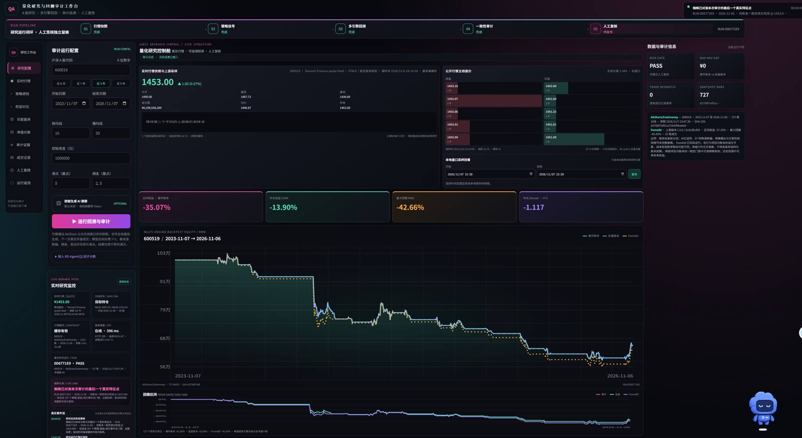
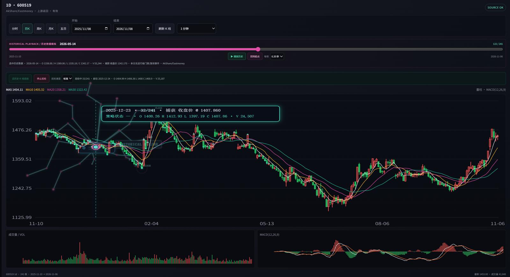

# Quant Audit Lab

面向 A 股日频策略研究的量化审计工作台。它获取带哈希的真实日线快照，将策略交给开源 `framebt` 因果回测引擎执行，并与本项目两套独立账本重放交叉观察；LangGraph Agent 汇总证据，研究员最终复核策略版本。

**项目页：** https://duoduohappy.github.io/quant-audit-lab/ · **源码：** https://github.com/duoduohappy/quant-audit-lab

GitHub Pages 页面用于项目介绍；实时行情与回测需要运行 Python/FastAPI 后端。仓库包含 `Dockerfile` 和 `render.yaml`，可在 Render 创建后端服务；部署完成后服务根地址会提供实际仪表盘和 API。不要把此静态介绍页说成已在线运行的实时回测。

## 系统截图

以下截图展示仓库中保存的工作台与历史蜘蛛回放界面。截图用于说明交互布局和可视化，不代表当前线上服务状态或实时行情状态。

### 研究工作台



### 历史行情与蜘蛛轨迹回放



## 目标业务闭环

真实行情 → 内容寻址快照 → 策略与参数 → `framebt` 因果回测 + 独立账本交叉核算 → 差异定位 → LangGraph 证据解释 → 人工复核 → 晋级或阻断策略版本。

系统不自动下单，也不让 LLM 计算收益、风险或审计结论。审计数字和门禁由确定性代码计算；Agent 只读取结构化证据并解释原因，所有解释须链接到证据行。

### 实时控制舱与蜘蛛运行轨迹

控制舱显示服务心跳、请求延迟、上游限流/冷却、日线快照缓存、真实逐股报价与公开五档盘口。逐股报价按后端缓存策略轮询，源时间和数据新鲜度单独显示；A 股历史策略审计使用日线数据，因此不是逐笔行情回测。行情服务不可用或返回过期数据时会显示离线/过期状态，不用动画或模拟数字冒充实时数据。

全屏蜘蛛是研究任务的可视化追踪器：浏览器订阅后端审计进度事件，它沿实际执行的行情快照、信号、双账本/framebt、对账、晋级门禁、证据解释和人工复核模块移动；失败会停在失败阶段，完成后显示门禁结果。蜘蛛不抓取市场数据、不产生策略信号，也不会替代任何审计逻辑。人工批准或阻断及原因保存在运行记录中，构成可回看的研究签核闭环。系统不连接交易账户、不下单。 页面按事件顺序播放已收到的阶段路线；批量返回的进度事件会依次经过对应模块。

## MVP 验收边界

- 通过 AkShare 获取 A 股日线，并将标准化行情快照按 SHA-256 写入 `data/snapshots/`。
- 集成 GitHub 上的 `framebt`（固定 commit），运行其真实因果回测引擎、A 股 T+1/涨跌停规则、成本模型、双均线策略及绩效计算。
- 两套项目内组合记账实现，对同一策略输入独立重放，负责一致性门禁；`framebt` 是第三条外部引擎参考曲线，不把不同成交/成本口径的净值差误报成账本故障。
- 明确模拟 A 股 T+1、涨跌停、手续费、印花税、滑点和次日成交。
- 产出逐日权益差异、逐笔成交记录和运行清单 JSON，保存在 `data/runs/`，记录快照哈希与全部参数。
- 浏览器仪表盘展示引擎净值差异、偏差瀑布、成交明细和证据/解释。
- 人工批准/阻断与原因写回运行审计记录；未通过确定性门禁的运行不能批准。
- 从 RD-Agent(Q)/Qlib 导入按日期的因子分数 JSON；记录因子、实验 ID、SHA-256 分数快照，并以阈值生成可复算目标状态，进入相同的 `framebt` 回测、双账本审计和人工签核。
- LangGraph 负责 Agent 工作流编排：先生成确定性规则解释，再按用户勾选决定是否进入 LLM 节点。默认关闭，零 Token；单次运行最多一次模型调用，只传摘要和最多 4 条证据，输出上限 240 tokens。

## 技术结构

- Python 3.12、FastAPI、Pandas
- Provider：AkShare / TuShare（可插拔）
- Engine：开源 `framebt` + 向量化参考账本 / 事件驱动账本
- Agent：LangGraph StateGraph + 可选 OpenAI-compatible 解释节点；只读证据，模型不能修改指标和门禁
- 前端：原生 HTML/CSS/JavaScript + SVG 图表（无构建步骤）

## 本地运行

```powershell
python -m venv .venv
.venv\Scripts\Activate.ps1
pip install -r requirements.txt
Copy-Item .env.example .env
uvicorn app.main:app --reload
```

`.env` 中的 LLM 配置全部可留空；只在用户自有兼容模型服务时再填写。不要把真实密钥提交到 Git。

### 在线部署

- 静态项目介绍页由 GitHub Actions 从 `docs/` 自动发布：<https://duoduohappy.github.io/quant-audit-lab/>。
- 后端可使用 Render Blueprint：在 Render 选择 **New → Blueprint**，连接此仓库并部署 `render.yaml`。无需设置 LLM 密钥也可以使用确定性审计流程；首次冷启动可能较慢。
- 后端部署完成后，通过 `https://<你的 Render 服务域名>/` 打开实时仪表盘，通过 `/api/health` 查看服务状态。Render 会分配服务域名，无法在未授权 Render 账号的情况下预先替用户创建。

首次运行需要联网下载实际行情。页面上会显示数据源、代码、日期范围、抓取时间和数据快照哈希。未配置 LLM 时明确标注规则 Agent；配置了兼容接口时也只让模型解释已有审计结果。

### RD-Agent(Q) 因子分数交接

RD-Agent(Q) 在独立的 Linux/Docker + Qlib 环境运行；本应用不会自动启动其研究循环。把研究输出整理为 `date,score` CSV 后转换：

```powershell
python scripts/rdagent_scores_to_json.py .\factor_scores.csv .\factor_candidate.json --factor momentum_quality --experiment run-001
```

在左侧展开“接入 RD-Agent(Q) 因子分数”，导入 JSON，设定分数阈值并运行。日期必须和 AkShare 行情交易日对齐，超出回测结束日的分数会被拒绝。上传的分数会按内容哈希保存；分数仅在当日收盘后生效，下一交易日才允许成交。RD-Agent 自身的迭代/模型费用由独立 worker 控制，不受这个仪表盘控制。

API：`GET /api/health`，`POST /api/audit`，`POST /api/factor-replay`，`POST /api/runs/{run_id}/decision`。因子回放接口接收 `factor_name`、`experiment_id`、`threshold` 和 `scores:[{date,score}]`，并复用行情、回测、审计与复核闭环。

### 小型自选池研究与纸面持仓

工作台另提供 `POST /api/research/scan`，每次最多扫描用户输入的 10 只沪深股票。它从 AkShare 适配器获取实际日线，结束日默认排除当天，保存行情来源、数据日期、快照 SHA-256、确定性特征和逐项评分。没有行情、过期回退或字段不全时会返回失败/风控阻断，不生成占位价格。

每个批次按服务端实际执行顺序追加 `SCAN_STARTED`、`MARKET_DATA_RECEIVED`、`FEATURES_GENERATED`、`SCORE_COMPUTED`、`RISK_GATE_DECIDED` 和 `SCAN_AUDIT_PERSISTED` 事件；数据读取/评分失败写入 `WATCHLIST_SCAN_FAILED`。前端用批次 UUID 轮询 `GET /api/research/events?batch_id=<uuid>&after=<cursor>`，蜘蛛只根据收到的持久化事件移动到对应阶段卡片。每条事件展示时间、事件 ID、完整 SHA-256 和可展开的载荷；事件载荷包含数据源/源时间、特征或评分拆解、风控规则与结果。纸面开平仓事件也留存行情来源、日线日期、快照哈希和审计 ID。数据缺失或过期时显示不可用/阻断，不补造结果。

评分为规则分数（0–100），各项可解释：收盘价相对 MA20（25）、MA5 与 MA20 趋势（15）、20 日动量（0–25）、成交量确认（0–15）、波动率质量（0–10）、距 20 日高点回撤（0–10）。独立风险门禁检查日线是否新鲜、波动率是否超过 80%、价格和成交量是否有效；评分高不能绕过门禁。默认纸面研究阈值为 60 分。

`GET /api/paper/state` 查询纸面账户；`POST /api/paper/{symbol}/open` 和 `/close` 只允许对最新真实扫描结果执行纸面状态转换。初始权益为 100 万元，单股敞口不超过初始权益 10%，总敞口不超过 30%，数量按 100 股一手校验。状态和扫描事件写入本地 SQLite 追加事件表，并通过前序哈希串联；接口回报审计链校验结果。该账户是演示用纸面账本，不连接券商、不发真实委托。Render 未配置持久磁盘时，本地 SQLite 数据可能随实例重建丢失。

## 状态与真实性声明

此仓库目前是研发中的 MVP，仓库提供 `tests/` 下的研究闭环自动化测试；README 不把测试文件存在等同于某次部署已验证。AkShare 与 `framebt` 的真实联网运行仍取决于部署网络和数据源可用性。不同引擎的手数、费用、成交约束可能不同，因此只把两套项目内账本一致性用于门禁；`framebt` 曲线展示为不同模型假设下的外部交叉参考。当前不处理完整除权复权、ST 特殊涨跌幅、停牌撮合等交易所细节。项目不会把历史回测表现表述为未来收益或实盘结果。

## 复用与差异化

项目不重复造通用回测引擎。`framebt` 采用 MIT 许可证并以固定 Git commit 作为依赖；LangGraph 采用其开源 StateGraph 编排模式；Microsoft RD-Agent(Q) 通过因子分数 handoff 接入研究闭环。RD-Agent 的研究循环仍在独立的 Qlib 环境中运行，本应用目前只支持单标的分数阈值回放，不应宣传为已把其多因子组合或自动进化运行时内嵌进来。

## 联系方式

- 微信号：Feizai0709
- 邮箱：229703643@qq.com
